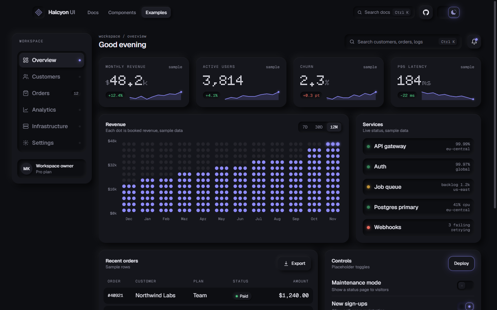

<div align="center">


# Halcyon UI

**Tactile React components you copy into your project.**
Soft raised and inset surfaces, dot-matrix icons, a glow that shifts from amber to violet, and springy motion.

[Documentation](https://mousewerk.github.io/halcyon-ui/) &nbsp;&middot;&nbsp;
[Components](https://mousewerk.github.io/halcyon-ui/#/docs/components/theme-switch) &nbsp;&middot;&nbsp;
[Dashboard example](https://mousewerk.github.io/halcyon-ui/#/examples/dashboard)


</div>

---

## What it is

Halcyon UI works like [shadcn/ui](https://ui.shadcn.com): it is **not** an npm dependency. A small CLI copies the source of each component into your app. From then on the code is yours to read, change and extend, and an update can never break your UI.

What makes it different is the design language:

| | |
|---|---|
| **Raised and inset** | Every element either floats above the page or is pressed into it. Light falls from the top left. |
| **One glow per theme** | Amber in light mode, violet in dark mode. It marks what is active, important or alive. |
| **Dot matrix** | Icons, numbers, charts, sliders and loaders are built from dots, like a hardware display. |
| **Weighted motion** | Spring easing everywhere. Keys sink, knobs stretch, cards rise in sequence, icons burst into particles and re-form. |

## Quick start

```bash
npx github:MouseWerk/halcyon-ui init
```

`init` detects your framework (Next.js, Vite, React Router / Remix, Astro), writes `halcyon.json`, copies the design tokens, the `cn()` helper and the theme hook, adds the token import to your global CSS and installs `clsx` and `tailwind-merge`.

Then add components:

```bash
npx github:MouseWerk/halcyon-ui add theme-switch stat dot-chart
npx github:MouseWerk/halcyon-ui add --all
npx github:MouseWerk/halcyon-ui list
```

Dependencies between components are resolved for you. Existing files are never overwritten unless you pass `--overwrite`.

### Works with the shadcn CLI

Every component is also a shadcn registry item, so it installs straight into an existing shadcn/ui project. The tokens are merged into your CSS automatically:

```bash
npx shadcn@latest add https://mousewerk.github.io/halcyon-ui/r/sidebar.json
```

Or register the namespace once in `components.json` and use short names:

```json
{ "registries": { "@halcyon": "https://mousewerk.github.io/halcyon-ui/r/{name}.json" } }
```

```bash
npx shadcn@latest add @halcyon/knob @halcyon/data-table
```

shadcn already uses `muted` for a background colour, so in shadcn projects Halcyon's secondary text colour is `text-hc-muted`.

```tsx
import { ThemeSwitch } from "@/components/ui/theme-switch"
import { Stat } from "@/components/ui/stat"

export default function Page() {
  return (
    <main className="p-10">
      <ThemeSwitch />
      <Stat label="Revenue" prefix="$" value={48.2} decimals={1} suffix="k" delta="+12.4%" spark={[18, 16, 20, 24, 27]} />
    </main>
  )
}
```

## Components



**80 components**, no runtime dependencies besides React, `clsx` and `tailwind-merge`.

| Group | Components |
|---|---|
| **Controls** | `theme-switch` `button` `button-group` `switch` `segmented` `toggle` `toggle-group` `chip` `knob` `copy-button` |
| **Forms** | `field` `input` `input-group` `textarea` `label` `checkbox` `radio-group` `slider` `select` `native-select` `combobox` `number-input` `otp-input` `password-input` `calendar` `date-picker` `file-drop` `rating` |
| **Surfaces** | `card` `item` `accordion` `collapsible` `carousel` `resizable` `aspect-ratio` `scroll-area` `separator` `avatar` `avatar-group` `dot-icon` `empty-state` |
| **Overlays** | `dialog` `alert-dialog` `sheet` `drawer` `popover` `hover-card` `tooltip` `dropdown-menu` `context-menu` `command` |
| **Data** | `chart` `data-table` `table` `stat` `dot-chart` `sparkline` `counter` `heatmap` `bar-list` `timeline` `progress-ring` |
| **Feedback** | `toast` `alert` `badge` `status-lamp` `meter` `progress` `skeleton` `spinner` `error-boundary` |
| **Navigation** | `sidebar` `navigation-menu` `menubar` `nav` `tabs` `breadcrumb` `pagination` `steps` `kbd` |

Everything shadcn/ui ships has a Halcyon counterpart, from Alert Dialog to Sidebar (Form is covered by `field`, which works with any form library; Sonner by `toast`).

<details>
<summary><b>All components with descriptions</b></summary>

| Component | What it does |
|---|---|
| `theme-switch` | The signature control. The dot-matrix sun bursts into particles and re-forms as a moon, the glow shifts from amber to violet and the new theme spreads out from the switch. Exports `<ThemeScript />` for flash-free SSR. |
| `button` | Raised key that sinks when pressed. Variants: default, glow, ghost, inset, danger. |
| `switch` | Tactile switch that lights up when on: glowing rim, halo and LED. |
| `segmented` | Segmented control with a spring-loaded thumb. |
| `input` | Recessed text field with icon and trailing slots. Glow ring on focus. |
| `textarea` | Recessed multi-line field with auto-grow and character counter. |
| `label` | Form label with an optional hint. |
| `checkbox` | Recessed box with a glowing key that pops in. Supports indeterminate. |
| `radio-group` | Wells with a springing glow bead and arrow-key navigation. |
| `slider` | Dot-track slider with a glowing knob and value bubble. |
| `select` | Raised trigger with a floating listbox, typeahead and full keyboard support. |
| `card` | Raised or inset surface with a staggered entrance. |
| `accordion` | Plates that sink into the page when opened. |
| `scroll-area` | Scroll container with edge fades and the tactile scrollbar. |
| `separator` | Engraved groove or dotted rule. |
| `avatar` | Raised round avatar with initials or an image. |
| `dot-icon` | Canvas icons from a 13 x 13 dot grid that morph through particles. Draw your own with `glyph()` or `bitmap()`. |
| `dialog` | Modal that rises out of a blurred page. Focus trap, scroll lock, Escape and backdrop close. |
| `sheet` | Floating side panel that springs in from any edge. |
| `popover` | Floating panel anchored to a trigger. Flips when there is no room. |
| `tooltip` | Raised label on hover and keyboard focus. |
| `dropdown-menu` | Menu with items, labels, separators, shortcuts and checkbox items. |
| `command` | Ctrl / Cmd + K command palette with fuzzy search and groups. |
| `stat` | KPI tile with a counting dot-matrix number, delta chip and sparkline. |
| `dot-chart` | Dot-matrix bar chart with a staggered pop-in. |
| `sparkline` | Sparkline in the theme glow that wipes in. |
| `counter` | Dot-matrix number that counts up and re-counts on change. |
| `table` | Rows are recessed strips that slide on hover. |
| `toast` | `toast()` from anywhere, `<Toaster />` springs messages up from the bottom. |
| `alert` | Recessed message well with a status LED. |
| `badge` | Status pill with a glowing dot. |
| `status-lamp` | LED whose breathing speeds up with severity. |
| `meter` | Dot-segment progress meter. |
| `skeleton` | Dot-matrix shimmer placeholder. |
| `spinner` | Ring of dots with a glowing comet. |
| `error-boundary` | Safety net: a failing part shows a retry panel instead of breaking the page. |
| `nav` | Recessed sidebar rail; the active item rises and its LED lights up. |
| `tabs` | Tabs in a recessed rail with a springing thumb. |
| `breadcrumb` | Monospace path with a raised current-page chip. |
| `pagination` | Page keys in a recessed rail. |
| `kbd` | Tiny raised keycap. |
| `toggle` | A key that stays down: sinks, glows and lights a corner LED when pressed. |
| `toggle-group` | Keys in a recessed rail, single or multiple selection, arrow-key navigation. |
| `chip` | Filter or tag pill. Selectable (sinks, dot lights up) and removable. |
| `knob` | Rotary dial with a lit dot ring. Drag, scroll or use the arrow keys. |
| `copy-button` | Copies to the clipboard; the icon swaps to a check that draws itself in. |
| `number-input` | Stepper with a dot-matrix value. Hold a key to repeat, type, or use arrows. |
| `otp-input` | One-time code wells with auto-advance, paste and SMS autofill. |
| `password-input` | Password field with a reveal key and a dot strength meter. |
| `combobox` | Searchable select with match highlighting and full keyboard control. |
| `calendar` | Month grid date picker with native-style keyboard navigation. |
| `file-drop` | Drop zone whose dotted border lights up and lifts while dragging. |
| `rating` | Stars drawn from dots. Hover preview, keyboard support, read-only mode. |
| `avatar-group` | Overlapping avatars that lift on hover, with a +N chip. |
| `empty-state` | Empty list placeholder: dot glyph in a well, text and an action. |
| `heatmap` | Dot-matrix heatmap, e.g. a year of activity. |
| `bar-list` | Ranked list with dot bars that grow in. |
| `timeline` | Activity feed on a dotted rail with status LEDs. |
| `progress-ring` | Circular dot progress around a recessed dial. |
| `progress` | Linear dot progress, determinate or an indeterminate comet. |
| `steps` | Step indicator for multi-step flows, horizontal or vertical. |
| `alert-dialog` | Confirmation that ignores backdrop clicks, focuses Cancel and waits for async actions. |
| `aspect-ratio` | Keeps media at a fixed ratio, optionally framed. |
| `button-group` | Joins buttons into one raised strip with engraved separators. |
| `carousel` | Scroll-snap carousel: swipe, arrows, dots, keyboard, autoplay. |
| `chart` | Area, line, bar and donut charts in plain SVG with tooltips and colour-blind-safe slots. |
| `collapsible` | Show/hide a section with animated height. |
| `context-menu` | Right-click / long-press / Shift+F10 menu at the pointer. |
| `data-table` | Sorting, search, row selection, pagination and a collapsible one-level tree. |
| `date-picker` | Calendar in a popover, single day or range. |
| `drawer` | Bottom drawer that follows your finger and dismisses on swipe. |
| `field` | Label, control, description and error wired with ids and aria attributes. |
| `hover-card` | Rich preview on hover or focus. |
| `input-group` | Input with icon, text and button addons in one well. |
| `item` | List row with media, title, description and actions. |
| `menubar` | Desktop-app menu bar with hover switching and arrow keys. |
| `native-select` | A real `<select>` styled as a raised key. |
| `navigation-menu` | Site navigation with dropdown link panels. |
| `resizable` | Split panels with draggable, keyboard-accessible dividers. |
| `sidebar` | App sidebar: icon rail on desktop (Ctrl/Cmd+B), off-canvas on phones. |

</details>

## Framework support

| | |
|---|---|
| **Next.js** | App Router and Pages Router. Interactive components carry `"use client"`, the theme hook uses `useSyncExternalStore` with a server snapshot, so there are no hydration warnings. Tested with a production build of Next.js 16. |
| **Vite** | Tested with Vite 8 and strict TypeScript. |
| **React Router / Remix** | `init` writes into `app/` and rewrites imports to the `~/` alias. |
| **Astro** | Works with `@astrojs/react`; hydrate interactive parts with `client:load`. |
| **Requirements** | React 18.2+ or 19, Tailwind CSS v4. |

Working setups live in [`examples/nextjs`](examples/nextjs) and [`examples/vite`](examples/vite). Both were created with the CLI and include every component.

<details>
<summary><b>Next.js root layout</b></summary>

```tsx
// src/app/layout.tsx
import { Geist, Geist_Mono, Doto } from "next/font/google"
import { ThemeScript } from "@/components/ui/theme-switch"
import { Toaster } from "@/components/ui/toast"
import "./globals.css"

const sans = Geist({ subsets: ["latin"], variable: "--hc-font-sans" })
const mono = Geist_Mono({ subsets: ["latin"], variable: "--hc-font-mono" })
const dot = Doto({ subsets: ["latin"], weight: ["600", "800", "900"], variable: "--hc-font-dot" })

export default function RootLayout({ children }: { children: React.ReactNode }) {
  return (
    <html lang="en" suppressHydrationWarning className={`${sans.variable} ${mono.variable} ${dot.variable}`}>
      <head><ThemeScript /></head>
      <body>{children}<Toaster /></body>
    </html>
  )
}
```

</details>

## Theming

Every color is a CSS variable with a light and a dark value, mapped to Tailwind utilities: `bg-surface`, `bg-raise`, `text-ink`, `text-muted`, `bg-glow`, `shadow-raised`, `shadow-inset`, `shadow-glow`, `ease-spring` and more. Change the glow in two lines:

```css
:root      { --hc-glow: #3ccf7a; --hc-glow-ink: #1d7d47; --hc-glow-soft: rgb(60 207 122 / .38); }
:root.dark { --hc-glow: #4fd8ff; --hc-glow-ink: #9be9ff; --hc-glow-soft: rgb(79 216 255 / .4); }
```

Dark mode is a `dark` class or `data-theme="dark"` on `<html>`. `useTheme()` handles both, remembers the choice, follows the OS until the user picks, and syncs across tabs.

## Built-in safety layer

`halcyon.css` ships a small base layer so apps stay stable on every device:

- No sideways page scroll and no layout jump when a scrollbar appears or a modal locks scrolling (`scrollbar-gutter: stable`).
- Slim tactile scrollbars that light up in the glow on hover, plus `scrollbar-none` and `scrollbar-inset` utilities.
- Inputs use 16px text on touch screens so iOS does not zoom in on focus.
- No grey tap flashes, safe text wrapping, `prefers-reduced-motion` respected everywhere.
- `<ErrorBoundary>` to fence off parts of the UI that might fail.

## Accessibility

Keyboard support follows the WAI-ARIA patterns: arrow keys in tabs, radio groups, menus, selects and the command palette; Home and End where it applies; Escape closes overlays; focus is trapped in modals and restored on close. Every animation turns off under `prefers-reduced-motion`. Text colors meet WCAG AA contrast (4.5:1) on every surface in both themes, and every page is scanned with axe in CI.

## Develop

```bash
git clone https://github.com/MouseWerk/halcyon-ui
cd halcyon-ui/www
npm install
npm run dev        # docs site on http://localhost:5173
npm run typecheck
npm run build
npm run e2e        # Playwright: every page and component, desktop / tablet / phone, light and dark
```

```
cli/            the halcyon CLI (no dependencies)
registry/       component sources, tokens, hooks and registry.json
www/            documentation and marketing site (Vite + React)
examples/       Next.js and Vite apps set up with the CLI
```

To add a component: put it in `registry/ui/`, list it in `registry/registry.json`, add a demo in `www/src/site/` and an entry in `www/src/site/catalog.ts` (the e2e suite checks they match).

The end-to-end suite lives in `www/e2e/`. Locally the phone and tablet projects emulate their devices on Chromium; in CI they also run on Firefox and WebKit (Safari).

## License

MIT
